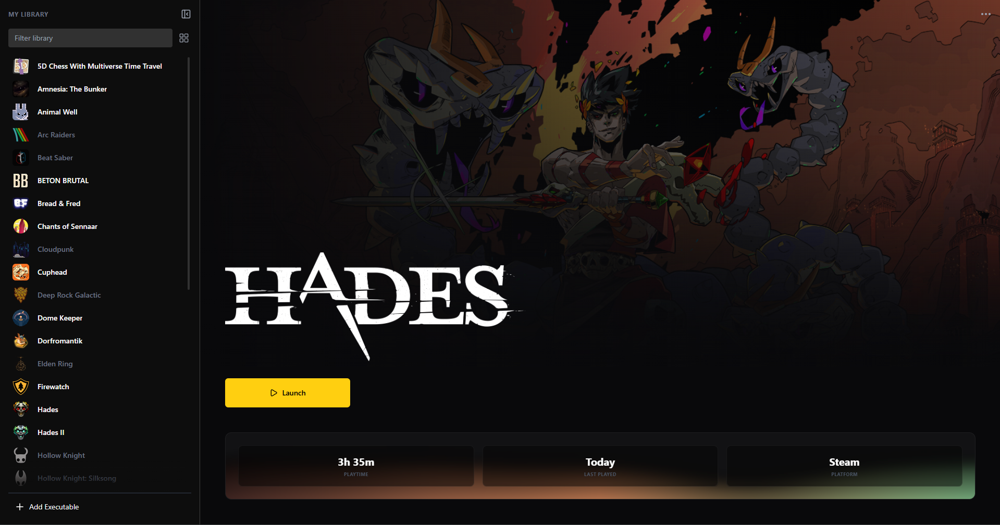

# Launcher

A simple, opinionated game launcher designed to organize your library without the bloat.

> "There are too many launchers, so I built one to rule them all."



## Features

- Minimal UI
- Grid Gallery View
- SteamGridDB Integration
- Playtime Tracking

## Getting Started

### Installation

You can grab the latest version for your operating system from the [Releases Page](https://github.com/Cuerillius/launcher/releases).

**Options:**

1.  **Installer:** Download the `.exe` and follow the setup instructions.
2.  **Portable:** Download the portable binary, unzip, and run directly.

## Developer Guide

If you want to contribute or modify the launcher, follow these steps to run it locally.

### Prerequisites

- [Bun](https://bun.sh/) (Runtime & Package Manager)

### Running Locally

1.  **Clone the repository**

    ```sh
    git clone https://github.com/Cuerillius/launcher.git
    cd launcher
    ```

2.  **Install dependencies**

    ```sh
    bun install
    ```

3.  **Start the application**

    ```sh
    # Run the app in development mode
    bun run start
    ```

4.  **Watch mode (for live development)**
    ```sh
    # specific command for hot-reloading/watching files
    bun run watch
    ```
